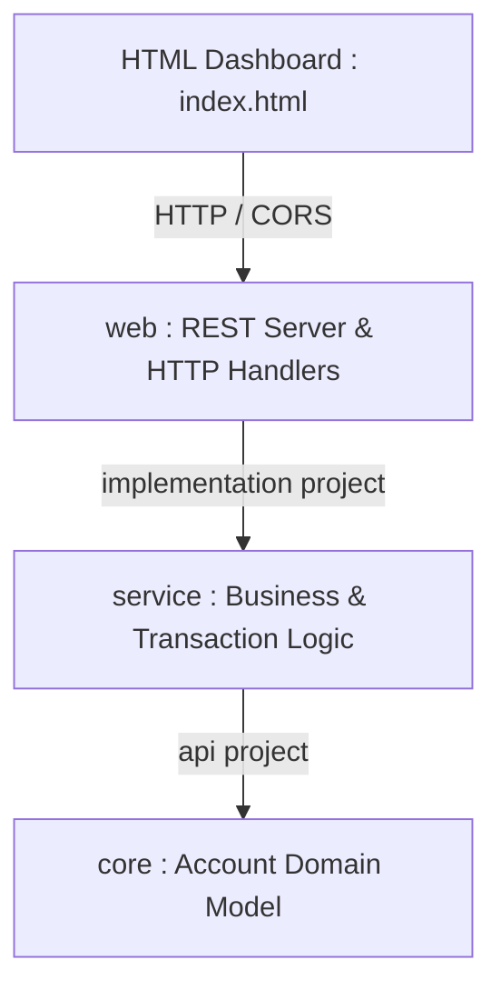

# 🏦 Multi-Module Banking System (Gradle)

[](https://gradle.org/)
[](https://adoptium.net/)

A clean multi-module banking application automated with **Gradle**, demonstrating decoupled software architecture, build automation, REST API controllers, an interactive web UI, and standalone deployable JAR packaging.

---

## 🎯 Aim & Practical Objectives

### Aim
> **To automate the software build process using Maven or Gradle and generate reliable, deployable application artifacts.**

### Problem Statement
Compiling and packaging applications manually leads to inconsistent builds across environments, classpath errors (`ClassNotFoundException`), and deployment delays. This project automates the entire lifecycle with Gradle to produce reliable, self-contained artifacts.

### Key Highlights
- **Multi-Project Build**: Modularized into `core`, `service`, and `web`.
- **Topological Compilation Order**: `web` $\rightarrow$ `service` $\rightarrow$ `core`.
- **Gradle Wrapper (`gradlew`)**: Ensures identical Gradle runtime (`8.14.6`) across all developer environments.
- **Fat JAR Packaging**: Bundles all runtime dependencies into `web/build/libs/web-1.0.0.jar`.
- **Interactive Web Dashboard**: Beautiful browser interface (`index.html`) connecting directly to local REST endpoints.
- **Incremental Builds**: Gradle rebuilds only what has changed (`UP-TO-DATE` optimization).

---

## 🏛 Architecture & Module Breakdown



| Module | Type | Description | Key File |
| :--- | :--- | :--- | :--- |
| **`core`** | Java Library | Domain entity: holds in-memory balance state and encapsulation. | `Account.java` |
| **`service`** | Java Library | Business coordination: deposit, withdrawal limit checks, and validation. | `BankService.java` |
| **`web`** | Application | Embedded HTTP REST server with CORS support on `http://127.0.0.1:8080`. | `BankingApplication.java` |
| **Dashboard** | Frontend | Modern HTML/CSS web interface to view balance and perform transactions. | `index.html` |

---

## 👥 Team Roles

| Role | Member | Responsibilities |
| :--- | :--- | :--- |
| **Build Architect** | Umeshraj | Gradle Wrapper configuration, `settings.gradle`, root `build.gradle`, build automation lifecycle. |
| **Core Domain Engineer** | Shruti | Core module setup (`core/build.gradle`), `Account.java` entity, balance encapsulation. |
| **Business Service Engineer** | Ishika | Service module setup (`service/build.gradle`), `BankService.java`, transaction validation logic. |
| **Interface & Deployment Lead** | Atharva | Web module setup (`web/build.gradle`), `BankingApplication.java` REST server, Fat JAR packaging, and `index.html`. |

---

## ⚙ Build Automation Configuration

### 1. `settings.gradle`
```groovy
rootProject.name = 'multi-module-banking-system'
include 'core'
include 'service'
include 'web'
```

### 2. Multi-Module Dependencies
- **`service/build.gradle`**:
  ```groovy
  plugins { id 'java-library' }
  dependencies { api project(':core') }
  ```
- **`web/build.gradle`**:
  ```groovy
  plugins { id 'application' }
  dependencies { implementation project(':service') }
  application { mainClass = 'com.bank.web.BankingApplication' }

  jar {
      manifest { attributes 'Main-Class': application.mainClass.get() }
      duplicatesStrategy = DuplicatesStrategy.EXCLUDE
      from { configurations.runtimeClasspath.collect { it.isDirectory() ? it : zipTree(it) } }
  }
  ```

---

## 🚀 How to Build & Run

### 1. Build the Deployable Artifacts
Run using the Gradle Wrapper:
```powershell
.\gradlew.bat clean build
```
This generates the standalone executable Fat JAR:
`web/build/libs/web-1.0.0.jar`

### 2. Start the Backend Server
Run the packaged JAR directly:
```powershell
java -jar .\web\build\libs\web-1.0.0.jar
```
*(Or via Gradle: `.\gradlew.bat :web:run`)*

Console Output:
```text
Banking API running at http://localhost:8080/balance
```

---

## 💻 Testing the System

### Option A: Web Dashboard (GUI)
Double-click **`index.html`** in your file explorer, or launch via PowerShell:
```powershell
Start-Process .\index.html
```
- Real-time balance display.
- One-click Deposit and Withdrawal.

### Option B: Terminal / REST Calls (PowerShell)
Open a second PowerShell window while the server is running:

- **Check Balance**:
  ```powershell
  Invoke-RestMethod -Uri 'http://localhost:8080/balance'
  ```
- **Deposit Money (e.g. ₹500)**:
  ```powershell
  Invoke-RestMethod -Method Post 'http://localhost:8080/deposit?amount=500'
  ```
- **Withdraw Money (e.g. ₹200)**:
  ```powershell
  Invoke-RestMethod -Method Post 'http://localhost:8080/withdraw?amount=200'
  ```

---

## ⚡ Incremental Build Demonstration (Viva Step)

1. Run `.\gradlew.bat build`. Notice all tasks report `UP-TO-DATE`.
2. Edit a single line in `core/src/main/java/com/bank/core/Account.java`.
3. Run `.\gradlew.bat build` again:
   - Notice `:core:compileJava` runs, while untouched tasks remain `UP-TO-DATE`.
   - Demonstrates Gradle's caching and incremental build performance.
